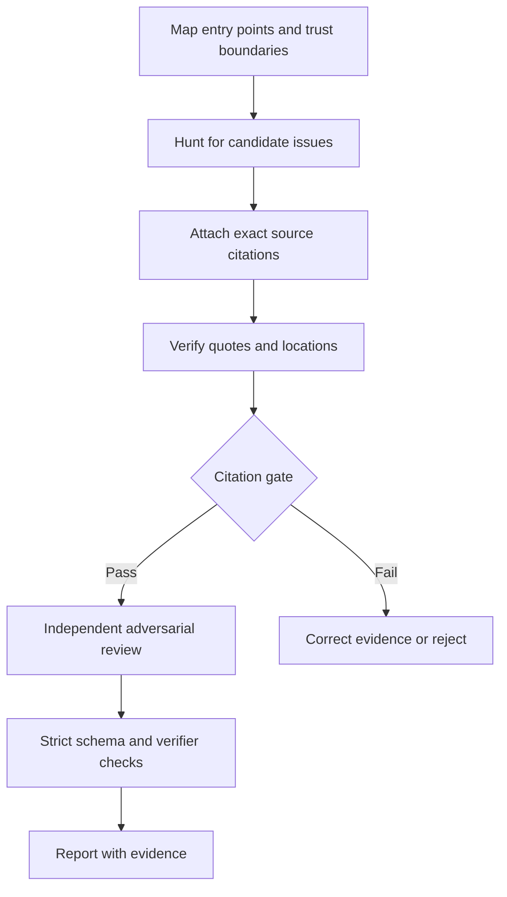

# proof-audit


A security-audit skill for coding agents in which **every finding has to prove its citations**.

AI security reviews have a known failure mode: findings that cite a file that doesn't exist, quote code that isn't there, or point at the wrong line. They read convincingly, and someone has to waste time disproving them. proof-audit makes every cited location carry a verbatim quote of the source, and a zero-dependency checker verifies each quote against the real files **before** a finding can reach the report.

```
$ proof-audit verify candidates.json --target ./vulnapp
PASS  ok-one [needs_validation] Real citation
FAIL  hallucinated [confirmed] Invented eval sink
      x src/server.js:11 QUOTE_NOT_FOUND - quoted text does not appear anywhere in the file
FAIL  drifted [needs_validation] Right code, wrong line
      x src/server.js:3 DRIFTED - quote is at line 16, not 3
FAIL  missing-file [needs_validation] File does not exist
      x src/auth.js:1 FILE_MISSING - no such file in target
FAIL  escape [needs_validation] Path escape
      x ../../../package.json:1 PATH_ESCAPE - '..' segments are not allowed
...
result: 8 finding(s) cite source that does not match
```

## How it works

The skill (`skills/proof-audit/SKILL.md`) runs a structured audit:

1. **Reconnaissance**: map entry points, trust boundaries, assets and existing controls; plan hunt units (entry-point group × attack class).
2. **Hunt**: fresh sub-agents per unit return candidates in a strict JSON format, with a quoted snippet for each location.
3. **Citation gate**: `proof-audit verify` schema-checks the candidates, rejects any location whose quoted text isn't at the cited place, and fixes nearby drifted line numbers (`--fix`). Only candidates that pass this gate go on to the verifier agents.
4. **Adversarial verification**: a different agent tries to refute each surviving candidate and decides `confirmed`, `needs_validation` (with the exact missing fact), or `rejected`.
5. **Final gate**: `validate` (schema) and `verify --strict` must both pass.
6. **Report**: `proof-audit report` renders Markdown from the verified records only, with quoted source under each finding, an *Excluded* list for anything whose citations failed, and a coverage table built from the hunt plan.

The safety rules are strict: source reading first, no contact with live systems, and target code runs only in a network-less sandbox, if at all.



## What the checker verifies

For each cited location:

| Check | Failure code |
|---|---|
| Path is repository-relative with forward slashes, has no `..`, and doesn't resolve outside the target via symlinks | `PATH_ESCAPE`, `PATH_INVALID` |
| File exists with exactly that spelling and case, and is a regular text file under 5 MB | `FILE_MISSING`, `NOT_A_FILE`, `NOT_TEXT`, `FILE_TOO_LARGE` |
| `line` and `end_line` are within the file; `end_line` is at most 50 lines after `line` | `LINE_OUT_OF_RANGE` |
| Every location has a quote with at least 6 non-space characters (not `});`) | `QUOTE_MISSING`, `QUOTE_TOO_SHORT` |
| Quote appears at the cited lines, without cutting identifiers in half (`exec(` never matches `safe_exec(`); indentation and runs of whitespace are ignored; multi-line quotes supported | `QUOTE_NOT_FOUND`, `AMBIGUOUS` |
| A quote that exists elsewhere: nearby moves are fixable, far ones are flagged | `DRIFTED`, `DRIFTED_FAR` |
| Findings were written for the commit the target is at (checked with `git rev-parse` only, so no hooks or filters from the audited repo ever run) | warning |

Schema rules: severity only on `confirmed`; `confirmed` needs an attacker, an asset, an entry point, a sink and a fix; `needs_validation` must name its blocker; `rejected` must say why. See [findings-format.md](skills/proof-audit/references/findings-format.md).

## Compared with cloudflare/security-audit-skill

[cloudflare/security-audit-skill](https://github.com/cloudflare/security-audit-skill) is an excellent, far more detailed audit methodology, and proof-audit borrows its best ideas: separate hunters and verifiers, the three verdicts, and strict local-only safety. The difference is in what is checked by code rather than by the model:

| | cloudflare/security-audit-skill | proof-audit |
|---|---|---|
| Citations | `file` + `line` per trace step | `file` + `line` + **verbatim `quote`** per location |
| Validators check citations against the source | No (the JSON schema and ledger are validated; source checks are left to verifier agents) | **Yes**: path containment, file existence, line range, quote match |
| Detects quotes or files that don't exist at the cited place | Only if a verifier agent notices | Deterministically, before verification |
| Repairs drifted line numbers | — | `verify --fix` |
| Report generation | Written by the agent from records | Rendered by script from verified records only |
| Coverage section | Detailed coverage ledger with its own validator | Coverage table built automatically from `coverage` in findings.json |
| Methodology depth | Very deep: 10 domain companion guides, budgets, profiles, multi-run ledger | Compact: one attack-class guide; intended to be easy to read and adapt |
| Checks *their* findings.json | — | Yes: `proof-audit verify` reads it and checks file/line existence (no quotes to match, so `QUOTE_MISSING` warnings) |

If you want maximum methodological depth, use Cloudflare's skill. You can still run `proof-audit verify` on its output to catch citations that point to files or lines that don't exist. We tested this with a record built by Cloudflare's own test fixtures: their validator accepts it, and `proof-audit verify` fails it as soon as a cited file is missing.

## Install

Copy `skills/proof-audit` into your agent's skills directory, for example:

```bash
git clone https://github.com/Ethos6/proof-audit
cp -r proof-audit/skills/proof-audit ~/.claude/skills/
```

or with the [Skills CLI](https://skills.sh):

```bash
npx skills add https://github.com/Ethos6/proof-audit --skill proof-audit
```

Then ask your agent: `security audit this codebase` or `check these findings for hallucinated citations`.

The checker needs only Node.js 18+. It also works on its own:

```bash
node skills/proof-audit/scripts/proof-audit.cjs validate findings.json
node skills/proof-audit/scripts/proof-audit.cjs verify   findings.json --target /path/to/repo [--strict] [--json]
node skills/proof-audit/scripts/proof-audit.cjs verify   findings.json --target /path/to/repo --fix --out fixed.json
node skills/proof-audit/scripts/proof-audit.cjs report   findings.json --target /path/to/repo --out REPORT.md
```

Exit codes: `0` OK, `1` invalid findings, failed citations, or (for `report`) findings excluded from the report, `2` usage or I/O error, `3` internal error. This makes the checker usable as a CI gate.

## Example

[examples/nodegoat](examples/nodegoat) is a real test run against [OWASP NodeGoat](https://github.com/OWASP/NodeGoat) at commit `c5cb68a`. One agent hunted two units, and a separate agent tried to refute each candidate. All 35 citations verified. The four confirmed findings: server-side `eval` injection (critical), missing admin authorization on `/benefits` (high), `$where` NoSQL injection (medium) and an IDOR on `/allocations` (medium).

To reproduce the check:

```bash
git clone https://github.com/OWASP/NodeGoat && git -C NodeGoat checkout c5cb68a
node skills/proof-audit/scripts/proof-audit.cjs verify examples/nodegoat/findings.json --target NodeGoat --strict
```

## Development

```bash
npm test
```

The test suite (47 tests) covers the failure codes, path-escape attempts (absolute, `..`, UNC, backslashes, symlinks, letter case), identifier-boundary matching, whitespace/CRLF handling, multi-line quotes, `--fix` limits, Markdown and terminal injection, malformed input, coverage rendering and CLI exit codes. Each safety check was also mutation-tested: disabling it makes at least one test fail (the letter-case check can only fail on case-insensitive file systems, so it is exercised by the macOS and Windows CI jobs; symlink tests are skipped on Windows runners without symlink privileges). CI runs the suite on Linux, macOS and Windows with Node 18, 20 and 22.

## Limits

- A matching quote proves the text exists where cited. It could still be inside a comment or a string literal, and it does not prove the vulnerability is real; judging that is the verifier agent's job.
- An audit covers the units it hunted. The report says which ones; it never claims the rest of the code is secure.

## License

MIT
